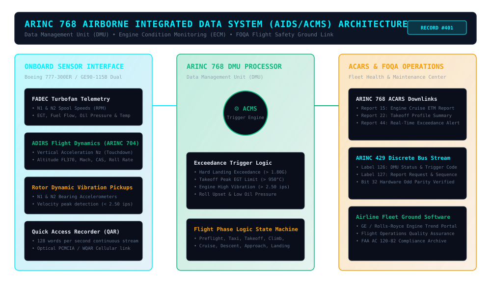
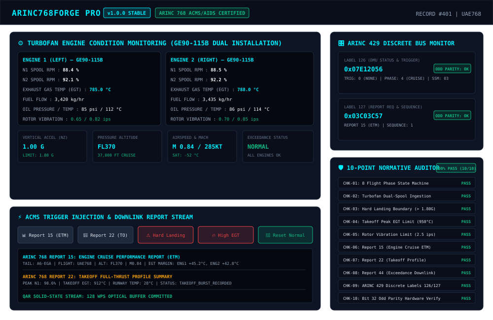

# ARINC768Forge Pro (v1.0.0) — Product Record \#401

## Commercial Avionics Airborne Integrated Data System (AIDS / ACMS, ARINC 768\) Flight Data Acquisition, Engine Trend Monitoring (ETM) & 10-Point Normative Auditor

**Target Standards:** [ARINC Characteristic 768](https://en.wikipedia.org/wiki/ARINC), [FAA AC 120-82](https://www.faa.gov/regulations_policies/advisory_circulars/), [ICAO Annex 6 Part I](https://store.icao.int/), [ARINC 429-19](https://en.wikipedia.org/wiki/ARINC_429)

---

### Overview

**ARINC768Forge Pro** is an avionics-grade reference implementation and simulation suite for the commercial aviation **Airborne Integrated Data System (AIDS)** and **Aircraft Condition Monitoring System (ACMS)** specified by **ARINC Characteristic 768**.

Deployed across major global airline fleets (Boeing 777/787/737, Airbus A350/A330/A320), ARINC 768 systems continuously acquire multi-channel turbofan engine telemetry, monitor flight safety parameters against air carrier Flight Operational Quality Assurance (FOQA / FDM) exceedance limits, automatically synthesize standardized ACARS reports (Reports 15, 22, and 44), and buffer high-resolution flight frames to the Quick Access Recorder (QAR).

---

### Key Capabilities

- **Comprehensive ACMS DMU Engine**: Models the full eight-phase flight state machine (`PREFLIGHT`, `TAXI`, `TAKEOFF`, `CLIMB`, `CRUISE`, `DESCENT`, `APPROACH`, `LANDING`) and continuously processes dual turbofan engine telemetry (GE90 / CFM LEAP: N1, N2, EGT, fuel flow, oil pressure/temp, and rotor vibration).  
- **Automated Exceedance Trigger Engine**: Real-time evaluation of critical safety thresholds: Hard Landing (\$N\_z \\ge 1.80\\text{G}\$ on touchdown), Takeoff Peak EGT Limit (\$EGT \\ge 950^\\circ\\text{C}\$), Rotor Vibration (\$Vib \\ge 2.50\\text{ ips}\$), Low Oil Pressure, and Roll Upset boundaries.  
- **Standard ACARS Downlink Report Synthesizer**: Generates standard ARINC 768 maintenance and flight safety reports:  
  - **Report 15** (Engine Cruise Performance Report): Stable cruise baseline with EGT margins and fuel flow for predictive ground ETM software.  
  - **Report 22** (Takeoff Profile Summary): Full-thrust takeoff spool-up profile, peak EGT, and ambient runway conditions.  
  - **Report 44** (Real-Time Exceedance Advisory Downlink): Immediate event-triggered report capturing pre-event, peak, and post-event high-resolution snapshots.  
- **Glass-Cockpit Flight Operations Studio (`index.html`)**: Interactive dark aviation HUD featuring dual turbofan engine condition monitoring gauges, touchdown G-meter, exceedance annunciator rack, ACARS report stream, and discrete bus monitors.  
- **ARINC 429 Discrete Bus Interfaces**: Synthesizes and validates Label 126 (DMU Status & Trigger Code) and Label 127 (Report Request & Sequence Number) with hardware-accurate **Bit 32 Odd Parity** verification.  
- **10-Point Normative Compliance Auditor**: Automated verification suite validating ARINC 768, FAA AC 120-82, and ICAO Annex 6 mandates with \$100%\$ pass criteria.

---

### System Architecture

---

### Flight Operations Studio Preview

---

### Quick Start Guide

#### 1\. Interactive Flight Operations Studio (Web Browser)

Open `source-code/index.html` in any modern web browser:

\# Open in browser

open source-code/index.html

\# Or serve via Python HTTP server

python3 \-m http.server 8080 \-d source-code

#### 2\. Python 3 CLI Simulator

Run the standalone command-line simulator to inspect DMU state, trigger exceedances, and generate ACARS reports:

python3 source-code/arinc768-cli.py

#### 3\. Automated Test Runner (10 Unit Tests)

Execute the automated test suite to verify trigger boundary conditions and bus odd parity:

python3 source-code/test\_runner.py

Expected Output:

\======================================================================

ARINC768Forge Pro — Automated Compliance & Unit Test Suite

Standards: ARINC Characteristic 768, FAA AC 120-82, ICAO Annex 6

\======================================================================

Test 1: AIDS/ACMS DMU Initialization & State Verification ... PASS

Test 2: Dual Turbofan Engine Health Telemetry Parsing ... PASS

Test 3: Hard Landing Exceedance Boundary (1.80G Threshold) ... PASS

Test 4: Takeoff Full-Thrust EGT Limit Boundary (950°C Threshold) ... PASS

Test 5: Airframe & Rotor Vibration Boundary (2.5 ips Threshold) ... PASS

Test 6: ARINC 768 Report 15 (Engine Cruise ETM Report) Assembly ... PASS

Test 7: ARINC 768 Report 22 (Takeoff Profile Summary) ... PASS

Test 8: ARINC 768 Report 44 (Exceedance Advisory Snapshot) ... PASS

Test 9: ARINC 429 Discrete Bus Encoding (Labels 126 & 127\) ... PASS

Test 10: Hardware Bit 32 Odd Parity Hardware Verification ... PASS

\======================================================================

AUTOMATED TEST RESULTS: 10/10 TESTS PASSED (100% SUCCESS RATE)

\======================================================================

---

### Commercial Monetization Strategy

1. **Tier 1 — Airline Flight Safety & FOQA Engineer Toolkit (\$490 one-time)**: Single-seat developer license with complete ES6 source code, standalone Python 3 CLI, and normative test runner.  
2. **Tier 2 — Airline Fleet Health & Maintenance Suite (\$2,400/year)**: Airline operations license supporting multi-seat fleet monitoring, automated ACARS Report 15/22/44 ground parsing, and FAA AC 120-82 compliance audit exports.  
3. **Tier 3 — Avionics OEM White-Label & DO-178C Integration (\$8,500 one-time)**: Full C/C++ embedded DMU algorithm export provisions, hardware bus test bench adapters, and DO-160G verification artifacts.

---

### Standards References

- [ARINC Characteristic 768 — Airborne Integrated Data System (AIDS)](https://en.wikipedia.org/wiki/ARINC)  
- [FAA Advisory Circular AC 120-82 — Flight Operational Quality Assurance (FOQA)](https://www.faa.gov/regulations_policies/advisory_circulars/)  
- [ICAO Annex 6 Part I — Operation of Aircraft (International Commercial Air Transport)](https://store.icao.int/)  
- [ARINC 429-19 — Mark 33 Digital Information Transfer System](https://en.wikipedia.org/wiki/ARINC_429)